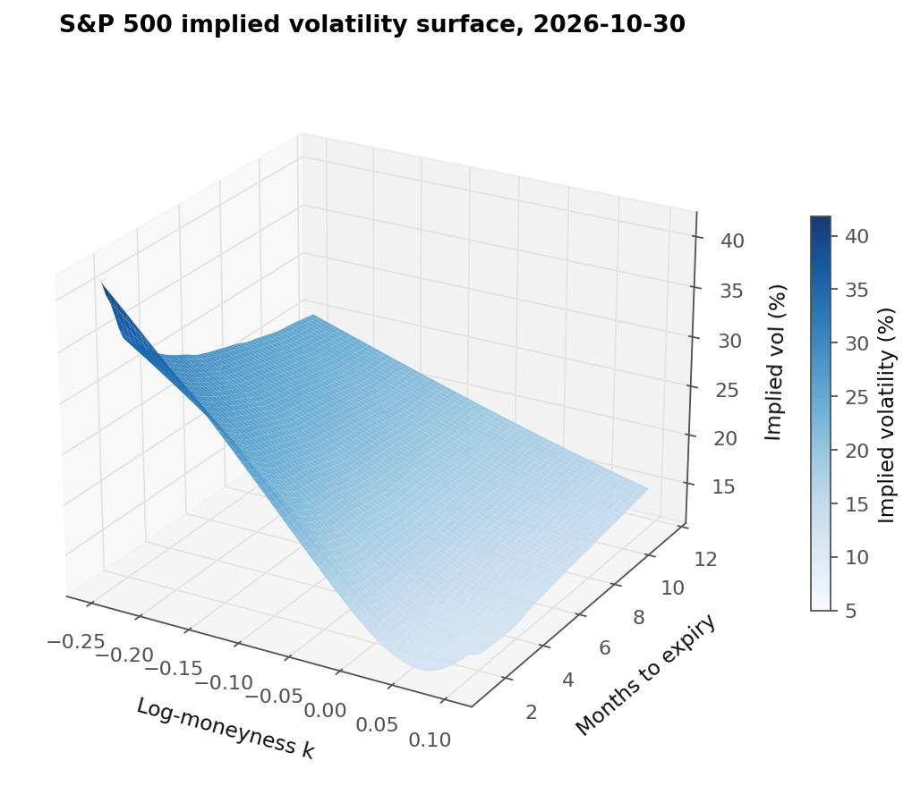
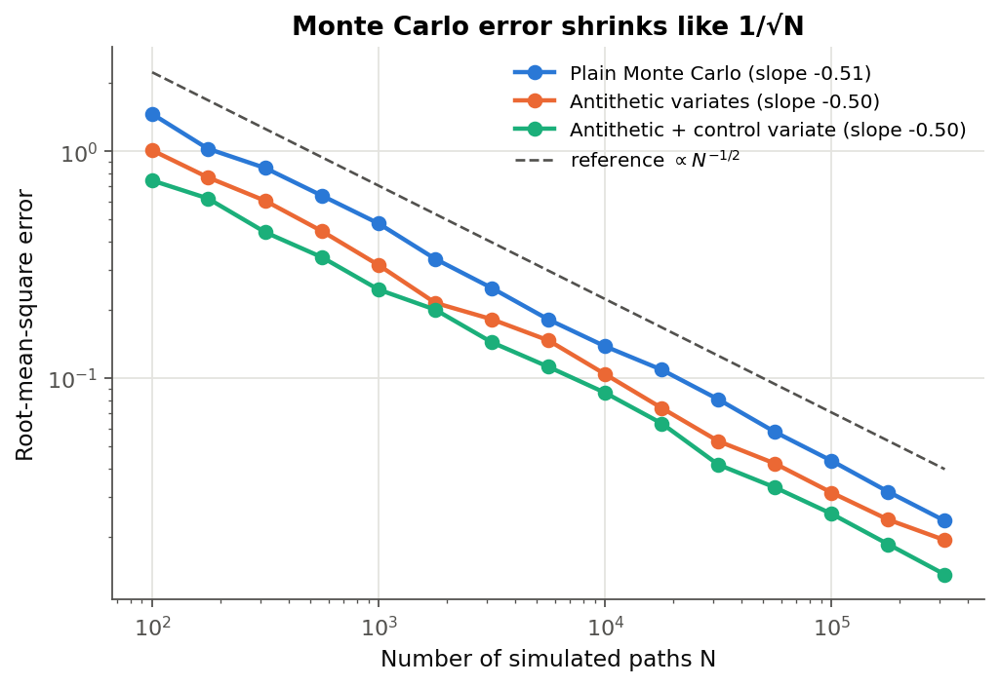
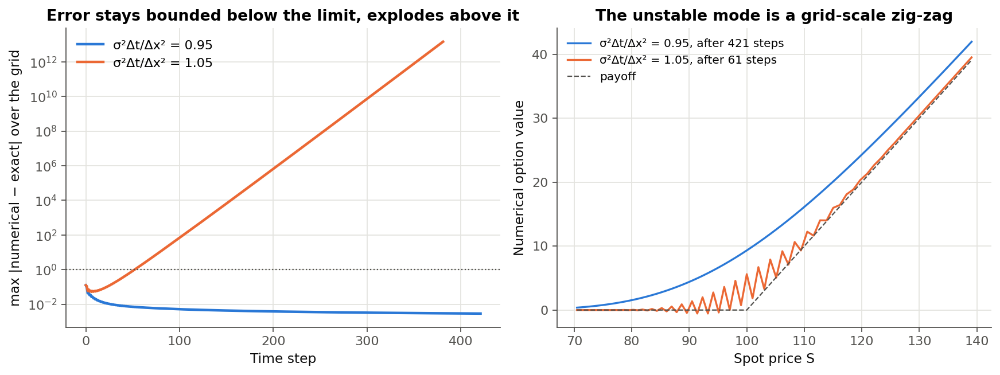
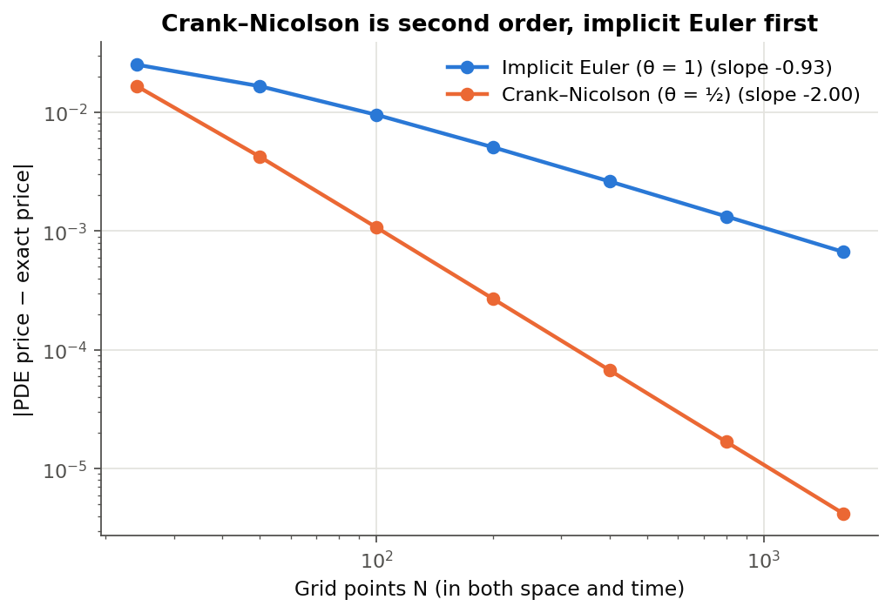
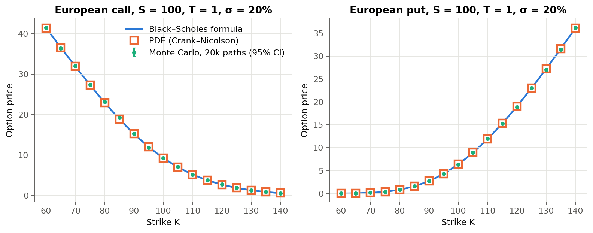
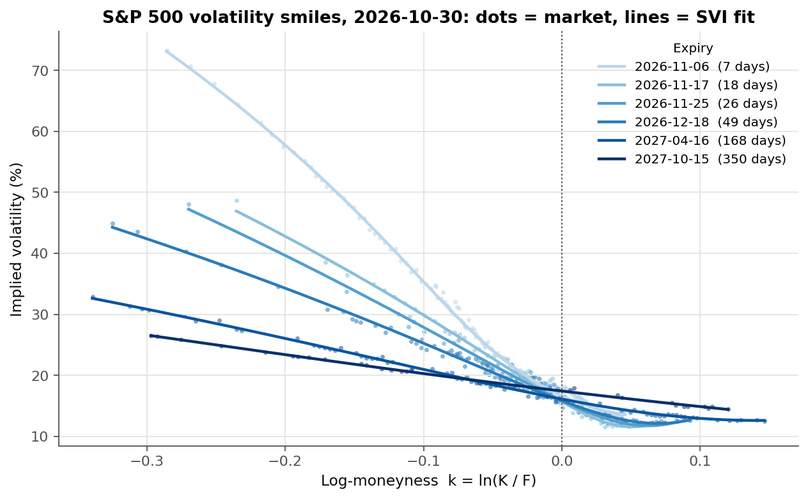
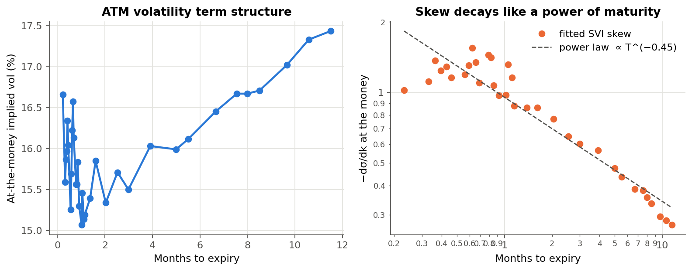

# Option Pricing Three Ways

Pricing European options with **(1) the Black–Scholes formula, (2) Monte Carlo simulation, and (3) a finite-difference PDE solver**, showing that all three converge to the same answer at the rates theory predicts, and then using the model in reverse to extract the **implied volatility surface** from 16,351 real S&P 500 option contracts.



Everything is written from scratch in Python using NumPy and SciPy only. The only external library is `yfinance`, used to download market data.

**Contents**

1. [Results at a glance](#1-results-at-a-glance)
2. [The model and the Black–Scholes PDE](#2-the-model-and-the-blackscholes-pde)
3. [Method 1: the closed-form solution](#3-method-1-the-closed-form-solution)
4. [Method 2: Monte Carlo simulation](#4-method-2-monte-carlo-simulation)
5. [Method 3: finite differences](#5-method-3-finite-differences)
6. [Implied volatility from real market data](#6-implied-volatility-from-real-market-data)
7. [What I checked](#7-what-i-checked)
8. [Limitations and next steps](#8-limitations-and-next-steps)
9. [Running the code](#9-running-the-code)

---

## 1. Results at a glance

| Question | Answer |
|---|---|
| Do the three methods agree? | Yes. Over 12 test options, the PDE matches the formula to within 6 × 10⁻⁵ and every Monte Carlo estimate lies within 1.3 standard errors ([table](#agreement-between-the-three-methods)). |
| Monte Carlo convergence rate | Error ∝ N^−0.50 (theory: N^−1/2). Variance reduction cuts the error by 42% at no extra cost. |
| Crank–Nicolson convergence rate | Error ∝ N^−2.00 (theory: second order). Implicit Euler: N^−0.93 (theory: first order). |
| Explicit scheme stability | Stable for σ²Δt/Δx² = 0.95; blows up to 10¹³ at 1.05, exactly as von Neumann analysis predicts. |
| Real market data | 2,660 implied volatilities across 38 expiries from the 30 Oct 2026 close. SVI smiles fit with a median error of 0.68 volatility points. |
| What the market says | At-the-money vol is 15–17%, with a strong negative skew that decays like T^−0.45 with maturity. The market's implied dividend yield is 1.0%. |

## 2. The model and the Black–Scholes PDE

**Assumption.** The stock price follows geometric Brownian motion,

$$dS_t = \mu S_t\,dt + \sigma S_t\,dW_t,$$

where $W_t$ is a Brownian motion, $\mu$ is the drift and $\sigma$ the volatility. The stock pays a continuous dividend yield $q$, and money can be borrowed or lent at a constant rate $r$.

**Itô's lemma.** For a smooth function $V(S,t)$, Taylor-expanding to second order and using the rule $(dW_t)^2 = dt$ gives

$$dV = \left(\frac{\partial V}{\partial t} + \mu S \frac{\partial V}{\partial S} + \tfrac12\sigma^2 S^2 \frac{\partial^2 V}{\partial S^2}\right)dt + \sigma S\frac{\partial V}{\partial S}\,dW_t.$$

Applied to $\ln S$, this shows that $\ln S_T$ is normally distributed:

$$\ln S_T = \ln S_0 + \left(\mu - \tfrac12\sigma^2\right)T + \sigma W_T.$$

**Delta hedging.** Hold one option and short $\Delta$ shares. The portfolio $\Pi = V - \Delta S$ changes by

$$d\Pi = dV - \Delta\,dS - q\Delta S\,dt,$$

where the last term is the dividend paid on the short position. The $dW_t$ terms are $\sigma S(\partial V/\partial S - \Delta)\,dW_t$, so choosing $\Delta = \partial V/\partial S$ removes all randomness. A riskless portfolio must earn the risk-free rate, $d\Pi = r\Pi\,dt$, otherwise there is an arbitrage. Equating the two gives the **Black–Scholes PDE**:

$$\boxed{\frac{\partial V}{\partial t} + \tfrac12\sigma^2 S^2 \frac{\partial^2 V}{\partial S^2} + (r-q) S \frac{\partial V}{\partial S} - rV = 0}$$

The drift $\mu$ has disappeared, so the option price does not depend on anyone's view of the expected return. The PDE is solved backwards from the payoff at expiry: $V(S,T) = \max(S-K,0)$ for a call and $\max(K-S,0)$ for a put.

Each of the three methods below solves this same problem in a different way.

## 3. Method 1: the closed-form solution

By the Feynman–Kac theorem, the solution of the PDE is a discounted expectation under the *risk-neutral* measure, in which the stock drifts at $r - q$ instead of $\mu$:

$$V(S_0, 0) = e^{-rT}\,\mathbb{E}^{\mathbb{Q}}\!\left[\text{payoff}(S_T)\right], \qquad S_T = S_0\, e^{(r-q-\frac12\sigma^2)T + \sigma\sqrt{T}Z},\quad Z\sim N(0,1).$$

**Derivation for a call.** The payoff is non-zero only when $S_T > K$, that is, when $Z > -d_2$, where

$$d_2 = \frac{\ln(S_0/K) + (r - q - \tfrac12\sigma^2)T}{\sigma\sqrt T}, \qquad d_1 = d_2 + \sigma\sqrt T.$$

Split the expectation into two parts:

$$\mathbb{E}\left[(S_T-K)^+\right] = \underbrace{\mathbb{E}\left[S_T\,\mathbf 1_{Z>-d_2}\right]}_{(A)} - K\,\underbrace{\mathbb{P}(Z > -d_2)}_{=\,N(d_2)}.$$

For (A), write the integral against the normal density and complete the square:

$$(A) = S_0 e^{(r-q)T}\int_{-d_2}^{\infty} \frac{1}{\sqrt{2\pi}}\, e^{-\frac12\sigma^2T + \sigma\sqrt T z - \frac12 z^2}\,dz = S_0 e^{(r-q)T}\int_{-d_2}^{\infty} \frac{1}{\sqrt{2\pi}}\, e^{-\frac12 (z-\sigma\sqrt T)^2}\,dz = S_0 e^{(r-q)T} N(d_1).$$

Multiplying by $e^{-rT}$ gives the **Black–Scholes formula**:

$$C = S_0 e^{-qT} N(d_1) - K e^{-rT} N(d_2), \qquad P = K e^{-rT} N(-d_2) - S_0 e^{-qT} N(-d_1).$$

These satisfy **put–call parity**, $C - P = S_0e^{-qT} - Ke^{-rT}$, which is used later to read the dividend yield from market prices.

Code: [`black_scholes.py`](src/optpricing/black_scholes.py). It also includes the Greeks (delta, gamma, vega and theta), each differentiated by hand and checked against numerical derivatives in the tests.

## 4. Method 2: Monte Carlo simulation

Instead of evaluating the expectation analytically, estimate it by averaging. Draw $Z_1,\dots,Z_N \sim N(0,1)$, compute each $S_T^{(i)}$ exactly using the formula above, and average:

$$\hat V_N = \frac1N\sum_{i=1}^N Y_i, \qquad Y_i = e^{-rT}\,\text{payoff}\big(S_T^{(i)}\big).$$

A European payoff depends only on $S_T$, so the simulation never needs to step through a whole path.

**Error.** By the central limit theorem, $\hat V_N$ is approximately normal with standard error $s_Y/\sqrt N$, where $s_Y$ is the sample standard deviation of the $Y_i$. Halving the error therefore costs four times as many simulations. The 95% confidence interval is $\hat V_N \pm 1.96\, s_Y/\sqrt N$.

**Variance reduction.** Since the error is $s_Y/\sqrt N$, the alternative to raising $N$ is to lower $s_Y$.

* **Antithetic variates.** Use each $Z_i$ twice, as $Z_i$ and $-Z_i$. If the two payoffs have correlation $\rho$, the average of the pair has variance $\tfrac12\text{Var}(Y)(1+\rho)$. A call payoff is increasing in $Z$, so $\rho < 0$ and the variance falls. (The pairs are not independent, so the standard error is computed from the $N/2$ pair averages, not from the individual $Y_i$.)
* **Control variate.** The discounted stock price $X = e^{-rT}S_T$ has a known mean, $S_0e^{-qT}$. The estimator $Y - \beta(X - \mathbb E X)$ has the same mean as $Y$ for any $\beta$. Its variance is minimised by $\beta^* = \text{Cov}(Y,X)/\text{Var}(X)$, which gives
  $$\text{Var}\big(Y - \beta^*(X-\mathbb EX)\big) = (1-\rho_{XY}^2)\,\text{Var}(Y).$$
  The more the payoff is correlated with the stock, the more noise this removes.



The RMSE over 200 independent runs falls with a fitted slope of **−0.50** for all three estimators, as the central limit theorem predicts. Variance reduction moves the whole line down: at 316,000 paths, the RMSE is 0.0235 for plain Monte Carlo, 0.0193 with antithetic variates, and 0.0136 with both techniques combined. That is the accuracy plain Monte Carlo would need about 3 times as many paths to reach.

**A side effect worth noticing.** In the [agreement table](#agreement-between-the-three-methods), the Monte Carlo call and put with the same strike and expiry are off by *exactly* the same number of standard errors. This is not a coincidence. The payoff difference $(S_T-K)^+ - (K-S_T)^+ = S_T - K$ is linear in the control variate, so the fitted $\beta$ values differ by exactly 1. The control-variate estimators then satisfy put–call parity *exactly*, sample by sample, and both carry the same error.

Code: [`monte_carlo.py`](src/optpricing/monte_carlo.py).

## 5. Method 3: finite differences

### Transforming the PDE

The PDE has coefficients $S^2$ and $S$ that change across the grid. Substituting $x = \ln S$ and time-to-expiry $\tau = T - t$ gives a constant-coefficient equation:

$$\frac{\partial V}{\partial \tau} = \tfrac12\sigma^2 \frac{\partial^2 V}{\partial x^2} + \left(r - q - \tfrac12\sigma^2\right)\frac{\partial V}{\partial x} - rV,$$

with the payoff as the *initial* condition at $\tau = 0$. This is a diffusion equation with a drift term, the same type of equation as the one that describes heat flow.

### Discretisation

Use a uniform grid $x_j = x_0 + j\Delta x$ that spans ±5 standard deviations of $\ln S_T$ and is centred so that today's spot lies exactly on a node. Replace the derivatives with central differences, which are second-order accurate:

$$\frac{\partial^2 V}{\partial x^2} \approx \frac{V_{j+1} - 2V_j + V_{j-1}}{\Delta x^2}, \qquad \frac{\partial V}{\partial x} \approx \frac{V_{j+1} - V_{j-1}}{2\Delta x}.$$

This turns the right-hand side into a tridiagonal matrix $L$ acting on the vector of grid values, $L V_j = aV_{j-1} + bV_j + cV_{j+1}$. Time is stepped with the **θ-scheme**:

$$(I - \theta\Delta\tau\,L)\,V^{n+1} = (I + (1-\theta)\Delta\tau\,L)\,V^n.$$

| θ | Scheme | Time accuracy | Stability |
|---|---|---|---|
| 0 | Explicit Euler | $O(\Delta\tau)$ | only if $\sigma^2\Delta\tau/\Delta x^2 \le 1$ |
| 1 | Implicit Euler | $O(\Delta\tau)$ | always |
| ½ | Crank–Nicolson | $O(\Delta\tau^2)$ | always |

Each implicit step solves a tridiagonal system in $O(N)$ operations (`scipy.linalg.solve_banded`). Boundary conditions come from the behaviour far from the strike: a call is worth 0 deep out of the money and $Se^{-q\tau} - Ke^{-r\tau}$ deep in the money, and similarly for a put.

### Why the explicit scheme has a stability limit

Look for solutions of the form $V_j^n = g^n e^{ij\xi}$, a single Fourier mode with amplification factor $g$ per step (von Neumann analysis). Considering only the diffusion term, one explicit step gives

$$g(\xi) = 1 - 2\lambda(1 - \cos\xi) = 1 - 4\lambda\sin^2(\xi/2), \qquad \lambda = \frac{\sigma^2\Delta\tau}{\Delta x^2}.$$

The worst mode is the grid-scale zig-zag, $\xi = \pi$, where $g = 1 - 2\lambda$. This satisfies $|g| \le 1$ only when $\lambda \le 1$. At $\lambda = 1.05$ the zig-zag grows by a factor of $|1-2.1| = 1.1$ every step. The experiment confirms this exactly: in the left panel below, the error climbs from 1 to 10¹³ in about 330 steps, and $1.1^{330} \approx 10^{13.7}$.



### Two refinements

1. **Payoff smoothing.** The payoff has a kink at $K$. Sampling it at the grid nodes makes the error depend on where the strike happens to fall between two nodes, and the convergence becomes erratic. Averaging the payoff over each grid cell instead (done exactly, since $e^x$ integrates in closed form) removes this effect.
2. **Rannacher start-up.** Crank–Nicolson damps high-frequency errors only weakly, so the kink can cause small oscillations. The first two steps use implicit Euler, which damps them strongly; the remaining steps use Crank–Nicolson.

### Convergence



With $N$ points in both space and time, the fitted slopes are **−2.00** for Crank–Nicolson and **−0.93** for implicit Euler, matching their theoretical orders. With 1,600 points, Crank–Nicolson is accurate to 4 × 10⁻⁶, which is 160 times better than implicit Euler on the same grid.

Code: [`finite_difference.py`](src/optpricing/finite_difference.py).

### Agreement between the three methods

Parameters: $S = 100$, $r = 4\%$, $q = 1\%$, $\sigma = 20\%$. Monte Carlo uses 1,000,000 paths with both variance-reduction techniques. The PDE uses an 800 × 800 Crank–Nicolson grid.

| Type | K | T | Black–Scholes | Monte Carlo (± 1 s.e.) | PDE (Crank–Nicolson) | MC error / s.e. | PDE error |
|---|---:|---:|---:|---:|---:|---:|---:|
| call | 80 | 0.25 | 20.5782 | 20.5787 ± 0.0004 | 20.5782 | +1.24 | +1.4e-05 |
| call | 80 | 1 | 22.9929 | 22.9912 ± 0.0032 | 22.9930 | -0.53 | +4.5e-05 |
| call | 100 | 0.25 | 4.3467 | 4.3446 ± 0.0042 | 4.3467 | -0.50 | +2.7e-06 |
| call | 100 | 1 | 9.3197 | 9.3160 ± 0.0080 | 9.3198 | -0.46 | +1.7e-05 |
| call | 120 | 0.25 | 0.1767 | 0.1752 ± 0.0012 | 0.1767 | -1.25 | +2.3e-05 |
| call | 120 | 1 | 2.7390 | 2.7392 ± 0.0063 | 2.7391 | +0.03 | +5.5e-05 |
| put | 80 | 0.25 | 0.0319 | 0.0324 ± 0.0004 | 0.0319 | +1.24 | +7.8e-06 |
| put | 80 | 1 | 0.8511 | 0.8494 ± 0.0032 | 0.8511 | -0.53 | +1.7e-05 |
| put | 100 | 0.25 | 3.6014 | 3.5993 ± 0.0042 | 3.6014 | -0.50 | -4.0e-06 |
| put | 100 | 1 | 6.3937 | 6.3900 ± 0.0080 | 6.3937 | -0.46 | -1.1e-05 |
| put | 120 | 0.25 | 19.2324 | 19.2309 ± 0.0012 | 19.2324 | -1.25 | +1.7e-05 |
| put | 120 | 1 | 19.0288 | 19.0290 ± 0.0063 | 19.0288 | +0.03 | +2.8e-05 |



## 6. Implied volatility from real market data

Everything in the Black–Scholes formula is observable except $\sigma$. Running the formula in reverse, the **implied volatility** of an option is the $\sigma$ that makes the model price equal the market price. If Black–Scholes were exactly right, every option on the S&P 500 would imply the same $\sigma$. The real data shows it does not.

### Solving for σ

Solve $f(\sigma) = BS(\sigma) - P_{\text{market}} = 0$. Since $\partial BS/\partial\sigma = \text{vega} > 0$, $f$ is strictly increasing, so the solution is **unique** whenever the price lies within the no-arbitrage bounds (for a call, $\max(S e^{-qT} - Ke^{-rT}, 0) < C < Se^{-qT}$).

**Newton's method** uses the derivative, which is available in closed form:

$$\sigma_{k+1} = \sigma_k - \frac{BS(\sigma_k) - P}{\text{vega}(\sigma_k)},$$

which converges quadratically close to the root. Far from the money, vega is tiny and a Newton step can overshoot, so the solver keeps a bracket $[\sigma_{lo}, \sigma_{hi}]$ around the root and takes a bisection step whenever a Newton step would leave it. This *safeguarded Newton* method always converges. The starting guess is the Brenner–Subrahmanyam approximation $\sigma_0 = \sqrt{2\pi/T}\,P/S$, which comes from a Taylor expansion of the at-the-money call price.

Code: [`implied_vol.py`](src/optpricing/implied_vol.py).

### Data and cleaning

* **Underlying:** the S&P 500 index (SPX). SPX options are **European** and cash-settled, which matches the model. (Options on the SPY ETF are American, so they would not.)
* **Snapshot:** the close on Friday 30 October 2026, SPX = 7,580.07, downloaded on the weekend with [`fetch_data.py`](scripts/fetch_data.py) and saved in [`data/`](data/), so every result can be reproduced offline.
* **Prices:** quoted bids and asks are zero on weekends, so each option's *last traded price* is used, and only trades from the final hour of the session are kept. This limits the mismatch between when the option traded and the closing index level.
* **Time to expiry:** measured in calendar time to the settlement moment. Weekly SPXW options settle at 4:00 pm ET; standard monthly SPX options settle at the 9:30 am open.
* **Interest rate:** the 13-week T-bill yield, converted from the market's discount-yield convention to continuous compounding: $r = 4.05\%$.
* **Dividend yield, from put–call parity.** For each matched pair of a call and a put at strike $K$, parity gives an estimate of the forward price, $F = K + e^{rT}(C - P)$. Taking the median per expiry and fitting $\ln(F/S) = (r-q)T$ across 27 expiries gives $r - q = 3.05\%$, so the market-implied **dividend yield is $q = 1.00\%$**, close to the S&P 500's actual dividend yield. (Estimating $r$ from parity as well was too noisy with last-trade prices, so $r$ comes from the T-bill.)
* **Which options:** only out-of-the-money options (puts below the forward, calls above), which trade more actively. Expiries shorter than 7 days and prices below $0.50 are dropped.

This leaves **2,660 implied volatilities across 38 expiries.**

### Smiles and the SVI fit

For each expiry, a smooth curve is fitted using Gatheral's **SVI** parameterisation of total implied variance $w = \sigma_{\text{imp}}^2 T$ as a function of log-moneyness $k = \ln(K/F)$:

$$w(k) = a + b\left(\rho(k-m) + \sqrt{(k-m)^2 + s^2}\right).$$

This is a hyperbola with five interpretable parameters: level $a$, wing slope $b$, skew $\rho$, shift $m$ and curvature $s$. Its wings grow linearly in $k$, which is the maximum rate allowed by Lee's moment formula. The fit is a robust non-linear least-squares problem (`scipy.optimize.least_squares` with a soft-L1 loss, so a few stale trades cannot pull the curve away).



SVI fits 34 of the expiries with a **median error of 0.68 volatility points** (the worst is 1.38).

### What the surface shows



1. **Black–Scholes is wrong in a specific, structured way.** Implied volatility is not constant. A 7-day put struck 25% below the forward ($k = \ln 0.75 \approx -0.29$) implies about 73% volatility, compared with about 17% at the money. The market prices large crashes as far more likely than the lognormal model does.
2. **The skew is steepest for short maturities and flattens with time.** The at-the-money slope $\partial\sigma/\partial k$ decays like $T^{-0.45}$, close to the $T^{-1/2}$ power law often reported for equity indices.
3. **At-the-money volatility rises with maturity**, from about 15% to 17.4% at one year. The short end is noisy: the index fell 1.8% that day, and last-trade prices from the final hour do not all line up with the 4 pm close.
4. **Calendar consistency.** Total variance should never decrease with maturity at fixed $k$, otherwise there is a calendar-spread arbitrage. The fitted surface violates this in 5.0% of adjacent-expiry comparisons beyond one month (9.3% including the noisy front end). These violations come from fitting each expiry separately, not from real arbitrage; a joint fit with constraints would remove them (see §8).

## 7. What I checked

The test suite (`pytest`, 60 test cases) checks every part independently of the figures:

| Check | How |
|---|---|
| Formula is right | Matches Hull's textbook example ($c = 4.76$, $p = 0.81$); put–call parity holds to 10⁻¹²; prices respect no-arbitrage bounds. |
| Greeks are right | Each analytic Greek matches a finite-difference derivative of the price. |
| Formula solves the PDE | $\Theta + \tfrac12\sigma^2S^2\Gamma + (r-q)S\Delta - rV = 0$ to within 10⁻¹⁰. |
| Monte Carlo is unbiased | Each estimator lies within 4 standard errors of the formula; 95% confidence intervals contain the true price about 95% of the time (400 trials). |
| Variance reduction works | Standard error: plain > antithetic > antithetic + control variate. |
| PDE is accurate | Crank–Nicolson within 10⁻³ of the formula across strikes; error ratios of about 4 (CN) and about 2 (implicit Euler) when the grid is refined. |
| Implied vol inverts the formula | Round trip $\sigma \to$ price $\to \sigma$ recovers $\sigma$ to 10⁻⁶ from 5% to 150% vol; arbitrage-violating prices are rejected. |
| Data pipeline | On a synthetic chain priced by Black–Scholes with a known $q$ and flat vol, the pipeline recovers $q$ to 10⁻⁶ and a flat smile. |
| SVI fitting | Recovers a known SVI smile to 10⁻⁴. |

Four implied-vol round trips are skipped on purpose: deep in- or out-of-the-money options at 5% vol, where the option's time value is below floating-point precision, so *no* method could recover $\sigma$.

## 8. Limitations and next steps

* **Constant volatility is the model's main flaw**, and §6 measures how far off it is. Natural extensions: Dupire local volatility (calibrated directly from this surface) or the Heston stochastic-volatility model (priced by Fourier inversion).
* **Last-trade prices are noisy.** Repeating the analysis during market hours with live bid/ask midpoints would sharpen the short end of the surface.
* **Arbitrage-free surface.** Fitting all expiries together with the no-calendar-arbitrage constraint (for example, Gatheral and Jacquier's SSVI) would remove the 5% violations.
* **American options.** Adding an early-exercise check to the finite-difference solver (a linear complementarity problem) would allow pricing SPY options and individual stocks.
* **Faster Monte Carlo.** Quasi-random (Sobol) sequences can improve the convergence rate from $N^{-1/2}$ to nearly $N^{-1}$.

## 9. Running the code

Requires Python 3.9+.

```bash
python -m venv .venv && source .venv/bin/activate
pip install -r requirements.txt

pytest                              # run all tests (~2 s)
python scripts/convergence.py       # Part 1: agreement table + convergence figures (~15 s)
python scripts/vol_surface.py       # Part 2: implied vols, SVI fits, surface (~10 s)
python scripts/fetch_data.py        # optional: download a fresh SPX snapshot
```

```
src/optpricing/
  black_scholes.py       closed-form prices and Greeks
  monte_carlo.py         Monte Carlo with antithetic and control variates
  finite_difference.py   θ-scheme PDE solver (explicit / implicit / Crank–Nicolson)
  implied_vol.py         safeguarded Newton solver
  market.py              data cleaning, forwards from put–call parity
  svi.py                 SVI smile fitting
scripts/                 reproduce every figure and table
tests/                   60 test cases
data/                    SPX option-chain snapshot, 30 Oct 2026
results/                 generated tables and implied vols
figures/                 generated figures
```

### References

* F. Black and M. Scholes (1973). *The Pricing of Options and Corporate Liabilities.* Journal of Political Economy.
* J. Hull. *Options, Futures, and Other Derivatives.*
* P. Glasserman (2003). *Monte Carlo Methods in Financial Engineering.* Springer.
* P. Wilmott, S. Howison and J. Dewynne (1995). *The Mathematics of Financial Derivatives.* Cambridge University Press.
* J. Gatheral (2006). *The Volatility Surface: A Practitioner's Guide.* Wiley.
* R. Rannacher (1984). *Finite element solution of diffusion problems with irregular data.* Numerische Mathematik.
